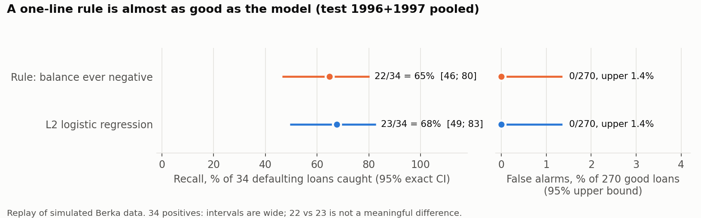
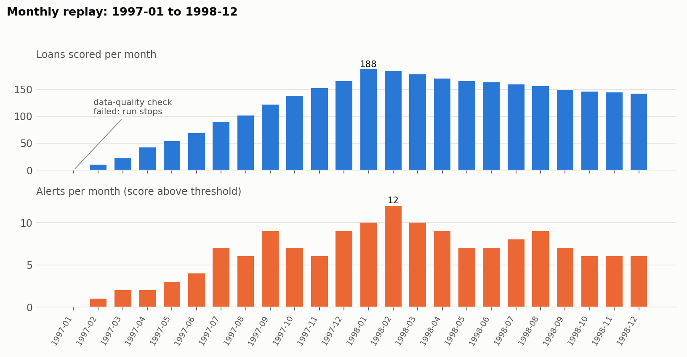
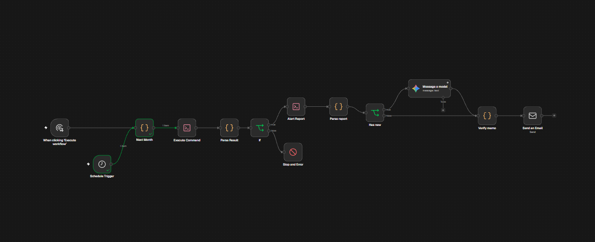
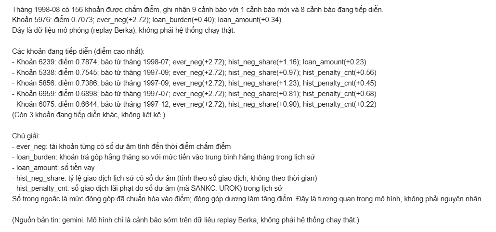
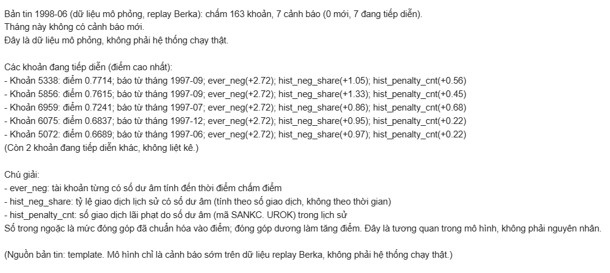
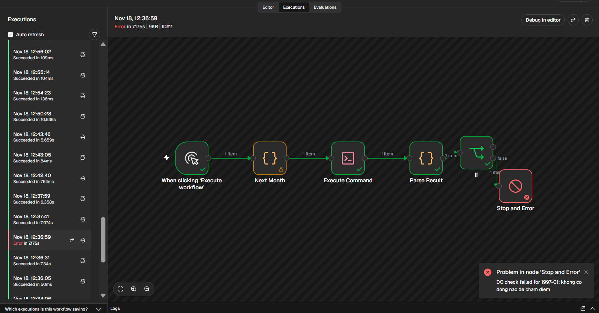

# Swallow: ngân hàng có thấy được khoản vay sắp hỏng trước khi nó hỏng không?

> **Đây là replay một bộ dữ liệu công khai thuộc thời mô phỏng (Berka, PKDD'99), không phải hệ thống chạy thật.** Chưa có gì được triển khai hay kiểm chứng trên danh mục thật, hiện hành. Các dẫn chiếu quy định chỉ là bối cảnh nghiên cứu; dự án không tuyên bố tuân thủ quy định nào.

## Câu hỏi

Ngân hàng duyệt một khoản vay, tiền được giải ngân, và một thời gian mọi thứ vẫn yên ổn. Rồi vài tháng sau, khách hàng ngừng trả. Câu hỏi tôi muốn trả lời nói thì dễ, làm cho trung thực thì khó: **sau khi giải ngân, một model đơn giản, giải thích được có cảnh báo sớm cho ngân hàng được không, sớm bao nhiêu tháng, và phải trả giá bao nhiêu báo động giả?**

Để biết, tôi dựng Swallow từ đầu đến cuối: SQL Server cho dữ liệu, một logistic regression có regularization L2 để chấm điểm, và một workflow n8n replay lịch sử ngân hàng từng tháng rồi gửi email bản tin cảnh báo.

## Một kết quả đẹp đến mức không thật

Bộ dữ liệu Berka có sẵn một cái bẫy, và là cái bẫy rất hay. Nếu bỏ qua thời gian và chỉ nhìn toàn bộ lịch sử giao dịch của từng khoản vay, có một luật tách khoản tốt và khoản xấu gần như hoàn hảo: số dư tài khoản có từng âm không? Mọi khoản xấu đều trả lời "có", còn khoản tốt thì "không". Kết quả sạch đến vậy phải khiến ta nghi ngờ, không phải ăn mừng.

Lý do là luật này nhìn trộm tương lai: nó dùng số dư ghi nhận sau khi khoản vay đã bắt đầu hỏng. Vì vậy mọi đặc trưng trong Swallow đều được tính **tại một mốc dự báo (as-of)**, chỉ dùng lịch sử đến ngày đó. Với ràng buộc này, bức tranh đổi hẳn. Ở tháng đầu tiên sau giải ngân, cùng tín hiệu đó bắt được 30 trên 76 khoản xấu, và mọi khoản nó bắt đều thật sự xấu. Đó mới là phiên bản nhỏ hơn nhưng dùng được của câu chuyện.

## Ba cái bẫy nữa và cách tôi xử lý

- **Khoản vay chưa kết thúc.** 403 trong 606 khoản "tốt" vẫn đang chạy, nên chúng không tốt, chỉ là chưa xấu. Tôi giữ nguyên bốn trạng thái gốc và coi khoản đang chạy là "chưa vỡ nợ tính đến nay", không bao giờ là "tốt". Bản thân sự kiện vỡ nợ là một đại diện: thiếu ít nhất hai kỳ trả góp.
- **Thế nào là xấu.** So chỉ các khoản đã kết thúc (A với B) cho một bài toán khác với dùng cả bốn trạng thái. Phân tích chính dùng cả bốn; bản chỉ A/B chỉ có 7 khoản dương, nên tôi báo là không kết luận được thay vì làm như có kết luận.
- **Chỉ 76 khoản xấu.** Ít như vậy thì một con số đơn lẻ gần như vô nghĩa. Tôi dùng khoảng tin cậy chính xác cho các tỷ lệ, bootstrap theo khoản vay cho lead time và AUC, và tách tập forward-chaining theo năm giải ngân, để model luôn được kiểm tra trên các khoản vay muộn hơn tập huấn luyện.
- **Dữ liệu thô.** Ngày dạng YYMMDD, nhiều cột đầy null, mã giao dịch tiếng Czech (PRIJEM, VYDAJ, VYBER, SIPO, DUCHOD, UVER). Tôi dựng lớp `clean` có kiểu dữ liệu đúng, bảng dịch mã và báo cáo chất lượng dữ liệu ở `reports/data_quality.md`. Bản CTU tôi dùng đã giải mã sẵn ngày sinh và giới tính, nên tôi không nhận phần đó là việc của mình.

## Những con số trung thực nói gì

Tập test gồm 34 khoản đã vỡ nợ và 270 khoản không vỡ nợ.

**Một luật đơn giản làm gần bằng model.** "Số dư từng âm" bắt 22 trên 34. Logistic regression bắt 23. Chênh một khoản không có ý nghĩa thống kê, và tôi thà nói thẳng như vậy còn hơn tô vẽ. Cả hai đều không báo nhầm trên 270 khoản tốt, nghĩa là tỷ lệ báo nhầm tối đa khoảng 1,4% (cận trên 95% chính xác).

*Hình 1. Recall (chấm) và khoảng tin cậy chính xác 95%. Với 34 khoản dương, hai khoảng gần như chồng hoàn toàn lên nhau.*

**Cảnh báo đến muộn.** Lead time median khoảng 1,0 đến 1,5 tháng, trong khi tối đa khả dụng khoảng 3 tháng. Recall nằm khoảng 50% đến 65% tùy cách định nghĩa vỡ nợ (thiếu ít nhất một hay ít nhất hai kỳ). Chỉ có 34 khoản dương nên khoảng tin cậy rộng khoảng ±17 điểm phần trăm: không phân biệt được 50% với 80%.

**Model thực sự nhìn vào gì.** Bốn đặc trưng lịch sử giữ nguyên dấu qua mọi lần bootstrap huấn luyện lại: số dư có từng âm không (mạnh nhất), tỷ lệ giao dịch có số dư âm, số lần bị tính lãi phạt (`SANKC. UROK`, lãi tính khi số dư âm), và gánh nặng khoản vay so với dòng tiền vào trung bình hằng tháng. Đây là tương quan, không phải nhân quả.

**Tuổi và giới tính có giúp không?** Tôi chạy model có và không có hai biến này. Recall không đổi (23/34 ở cả hai), và chênh AUC theo cặp là -0,045 [-0,106; 0,003] và +0,011 [-0,012; 0,031]. Nghĩa là "chưa thấy bằng chứng", không phải "đã chứng minh không có", và đây cũng không phải kiểm tra công bằng.

**Vì sao tôi tin điểm này không phải rò rỉ.** AUC cấp dòng trên test là 0,836 [0,714; 0,943] và 0,874 [0,800; 0,952] ở hai fold: tốt, nhưng xa mức 1.

Một quan sát cuối tôi thấy thật sự thú vị: trong toàn bộ dữ liệu, không khoản vay tốt nào từng có số dư âm, trong khi 5,6% tài khoản không vay từng âm. Điều đó gợi ý ngân hàng đã sàng lọc người xin vay rủi ro trước khi duyệt. Berka không có hồ sơ bị từ chối nên tôi không chứng minh được, nhưng đó là lý do đủ tốt để thận trọng với con số 0 báo nhầm quá sạch.

## Cho nó chạy mỗi tháng

Một model nằm trên laptop chưa phải một quy trình, nên tôi bọc nó trong một quy trình hằng tháng. Workflow n8n replay từng tháng một:

    Schedule Trigger -> Next Month (con trỏ) -> score_month.py -> kiểm tra chất lượng dữ liệu
       (lỗi: dừng và báo lỗi) -> alert_report.py -> có cảnh báo mới?
       -> Gemini viết bản tin (free tier) -> Verify memo -> email

`src/score_month.py` chấm điểm một tháng và ghi `mart.alerts` (không chứa nhãn) cùng `mart.run_log`. `src/alert_report.py` tách cảnh báo **mới**, lần đầu bị báo, khỏi cảnh báo **đang tiếp diễn**, để bản tin không lặp lại.

Phần tôi quan tâm nhất là `Verify memo`. LLM được phép viết bản tin nhưng không được tin tưởng hoàn toàn: mọi con số trong văn bản phải có trong báo cáo cảnh báo và mọi khoản mới phải được nêu tên, nếu không bản tin sẽ bị thay bằng bản do code dựng. Phép kiểm tra này bắt số sai chứ không bắt nghĩa sai, và tôi học điều đó theo cách khó khi Gemini giải thích sai một đặc trưng. Vì thế phần chú giải ý nghĩa các đặc trưng giờ do code thêm vào, không để model viết.

Replay chấm 23 tháng (1997-02 đến 1998-12). Tháng 1/1997 cố ý không qua bước kiểm tra chất lượng dữ liệu, để chứng minh nhánh "dữ liệu xấu thì dừng" hoạt động. Trên toàn replay, các cảnh báo trúng 15 khoản dương, 0 khoản âm và 8 khoản xấu nhưng không có mốc vỡ nợ; khớp với test 1997.

Nó cũng từng hỏng, và tôi ghi lại trung thực: tháng 7/1998 hạn mức miễn phí theo ngày của Gemini cạn, bản tin tháng đó bị mất trong khi con trỏ tháng đã tiến lên. Tôi giữ hạn chế này lại và ghi rõ ra thay vì giấu.

File xuất workflow là `n8n/swallow_workflow.json` (địa chỉ email là placeholder; credential chỉ nằm trong n8n). Khởi động n8n cục bộ bằng `scripts/start_n8n.ps1`.

*Hình 2. Số khoản được chấm và số cảnh báo mỗi tháng trong replay. Tháng 1/1997 dừng vì không qua kiểm tra chất lượng dữ liệu, đúng như thiết kế.*

Bằng chứng chạy thật trên n8n (ảnh chụp từ máy của tôi, địa chỉ email đã được che):

*Hình 3. Toàn bộ workflow trên canvas n8n, từ Schedule Trigger đến Send an Email.*

*Hình 4. Bản tin tháng 1998-08 (chạy tay) do Gemini viết và đã qua Verify memo. Danh sách cảnh báo tiếp diễn và phần chú giải do code thêm sau khi kiểm tra.*

*Hình 5. Bản tin tháng 1998-06: 7 cảnh báo, không có cái nào mới, nên bản tin do code dựng (nguồn template) và không gọi Gemini.*

*Hình 6. Lần chạy tay với tháng 1/1997 (tôi đặt tạm tháng này để kiểm thử nhánh lỗi, vì lịch replay bắt đầu từ 1997-02): workflow dừng ở Stop and Error vì không qua kiểm tra chất lượng dữ liệu, đúng như thiết kế.*

## Những điều tôi không khẳng định

- Đây là replay dữ liệu mô phỏng của một ngân hàng ở một thời kỳ, và chỉ có các khoản vay đã được duyệt (thiên lệch chọn mẫu).
- Bộ đặc trưng được chốt sau khi tôi đã thấy kết quả baseline trên tập test (tôi không tinh chỉnh theo test); phần so sánh model và phân tích "nhóm im lặng" là khám phá.
- Kẽ hở nhãn theo thời gian (label-time leakage) **chưa được kiểm chứng**: lần chạy độ nhạy với nhãn nghiêm ngặt bị suy biến nên tôi không diễn giải.
- Kiểm tra nhân khẩu học không phải kiểm tra công bằng; các biến đại diện chưa được xét.
- 30 trên 682 khoản vay có chủ dưới 18 tuổi lúc vay và tôi chưa biết vì sao. Số tiền lãi lệch ±1 ở khoảng 21% dòng, cũng chưa giải thích được.
- Khoảng một phần ba các khoản vỡ nợ (11 trên 34) không có tín hiệu số dư âm nào, và cả luật lẫn model đều không bắt được.
- `Execute Command` được bật trong n8n, chỉ chấp nhận được trên instance cục bộ một người dùng, bind 127.0.0.1.

## Vì sao điều này quan trọng (bối cảnh nghiên cứu, không phải tuyên bố tuân thủ)

Khung bài toán lấy cảm hứng từ các diễn biến trong nước và quốc tế: dự thảo quy định quản trị AI của Ngân hàng Nhà nước, Thông tư 46/2026/TT-NHNN về sự đồng ý khi chia sẻ dữ liệu tín dụng, EU AI Act xếp chấm điểm tín dụng là rủi ro cao, và SR 26-2 ở Mỹ. Dự án này không thực thi nghĩa vụ nào trong số đó.

## Chạy lại

> Trình tự dưới đây được suy ra từ cấu trúc repo và phần hướng dẫn ở đầu mỗi script. **Tôi chưa chạy lại toàn bộ từ một máy trống**, nên coi đây là hướng dẫn có khả năng cần chỉnh khi gặp lỗi. Riêng bước chấm điểm replay (mục 5) đã được kiểm chứng tái hiện: chạy lại cả 24 tháng, `n_scored`, `n_alerts` và `max_score` (làm tròn 4 chữ số) trùng khớp từng tháng với log gốc (`python src\compare_replay.py`). Việc này chỉ chứng minh bước chấm điểm với model đã lưu lặp lại được; nó không kiểm tra việc huấn luyện lại hay nạp lại dữ liệu từ đầu.

**Cần có:** Windows, SQL Server chạy cục bộ (đăng nhập Windows; nếu dùng instance tên riêng, đặt `$env:SWALLOW_SQL_SERVER=".\SQLEXPRESS"`), ODBC Driver 18 for SQL Server, Python 3.11 (tôi dùng 3.11.8), kết nối mạng để kéo dữ liệu từ CTU. Cài thư viện bằng `pip install -r requirements.txt`. Database `Swallow` và các schema `stg`, `clean`, `mart` được script tự tạo.

1. **Dữ liệu:** `python src\pull_berka.py` (kéo 8 bảng từ tài khoản công khai chỉ đọc của CTU), `python src\load_staging.py` (nạp vào `stg` và so khớp số dòng), `python src\data_quality.py` (ghi `reports/data_quality.md`).
2. **Làm sạch và đặc trưng:** chạy lần lượt theo số thứ tự bằng `python src\run_sql.py sql\<tên file>.sql`, từ `01_clean.sql` đến `13_features.sql` (các file 02 đến 07 và 09 đến 12 chủ yếu là kiểm chứng dữ liệu, nhãn và mốc; `08` tạo mốc vỡ nợ và lưới as-of; `13` tạo đặc trưng), rồi `17_demographics.sql`. Các file `14`, `15`, `16`, `18` là chứng minh và chẩn đoán (leakage, số dư âm, nhân khẩu học), chạy tùy chọn.
3. **Bộ dữ liệu mô hình:** `python src\export_dataset.py` (ra `data/processed`), `python src\check_dataset.py`.
4. **Mô hình và đánh giá:** `python src\baseline_rule.py`, `python src\model_lr.py` (bộ core), `python src\model_lr.py demo` (thêm giới tính và tuổi); các phân tích khám phá `compare_models.py`, `silent_group_check.py`, `sensitivity.py`; cuối cùng `python src\train_final.py` ra `models/lr_core_train1993_96.joblib`. Các script in kết quả ra màn hình; các file trong `reports/*.txt` là bản lưu đầu ra.
5. **Replay và giám sát:** `.\scripts\replay_all.ps1` chấm 24 tháng và ghi `reports/replay_log_rerun.jsonl` (tháng 1997-01 dừng ở kiểm tra chất lượng dữ liệu, đúng thiết kế); `python src\compare_replay.py` so từng tháng với log gốc; sau đó `sql\19_replay_check.sql`, `sql\20_new_alert_months.sql`, `sql\21_alert_kpi_monthly.sql`; xem báo cáo một tháng bằng `python src\alert_report.py --month 1998-08`; vẽ hình bằng `python src\make_figures.py` (đọc `reports/replay_log.jsonl`). Log replay gốc trong repo được ghi bằng PowerShell nên mã hóa UTF-16; script vẽ hình tự nhận diện.
6. **n8n (tùy chọn):** `scripts\start_n8n.ps1` (cần Node 24 qua `fnm`, n8n 2.48.4), nhập `n8n/swallow_workflow.json`, rồi tự cấu hình Credentials (SMTP Gmail với App Password, khóa Gemini) trong n8n và sửa đường dẫn Python tuyệt đối trong node Execute Command cho đúng máy của bạn. File workflow không chứa khóa hay mật khẩu.

## Trạng thái

Model card: xem `MODEL_CARD.md` (bản nháp). Bảng KPI theo tháng: `sql/21_alert_kpi_monthly.sql` (bảng `mart.alert_kpi_monthly`); từ điển chỉ số: `reports/metrics_dictionary.md`.
